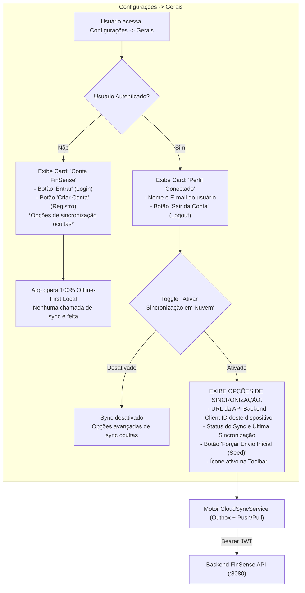

# Guia de Integração do Cliente: FinSense macOS & Backend Two-Way Sync (Agent-First)

> **Manual Canônico de Engenharia de Software Orientado a Agentes Autônomos (Agent-First)**  
> **Documento:** Roteiro de Implementação da Camada Cliente: Registro, Autenticação, Controle de Sessão e Sincronização Bidirecional  
> **Target:** AI Coding Agents, macOS (SwiftUI) & iOS Client Engineers  
> **Referência Canônica da API:** [BACKEND_SPECIFICATION.md](file:///Users/clovis/projetos/FinSense-api/BACKEND_SPECIFICATION.md)  
> **Versão do Guia:** 2.2.0  
> **Status:** Aprovado para Execução e Implementação Automatizada  
> **Data de Emissão:** 2026-11-08  

---

## 1. Manifesto de Integração & Diretrizes de Execução para Agentes

```yaml
agent_manifest:
  name: "FinSense Client Cloud Sync & Auth Integration"
  version: "2.2.0"
  target_os: "macOS 14.0+ (Sonoma/Sequoia) / iOS 17.0+"
  language: "Swift 5.9+ / SwiftUI / Combine / Network.framework / Security (Keychain)"
  project_root: "/Users/clovis/projetos/FinSense"
  backend_api_base_url_local: "http://localhost:8080/api/v1"
  backend_api_base_url_production: "https://api.finsense.com.br/v1"
  architecture_pattern: "Offline-First Local Storage + Gated Two-Way Sync Engine"

execution_invariants:
  inv_01_zero_blocking:
    rule: "NUNCA bloquear a thread principal (Main Thread) ou exibir modais bloqueantes aguardando resposta de rede."
    latency_threshold_ms: 10
    behavior: "Toda alteração do usuário é persistida no banco local JSON imediatamente antes de qualquer tentativa HTTP."
  inv_02_strictly_gated_sync:
    rule: "Até que o usuário autentique E habilite a sincronização, o app se mantém exatamente como está (100% offline-first local)."
    behavior: "Se não autenticado, nenhum socket é aberto, nenhuma chamada de rede é feita e as opções de sync NÃO aparecem na interface."
  inv_03_settings_hierarchy:
    rule: "A opção de autenticar DEVE residir em 'Configurações -> Gerais'. As opções de sincronização só se tornam visíveis quando o usuário estiver autenticado E o toggle de sincronização for ativado."
  inv_04_graceful_server_down:
    rule: "Se o servidor backend estiver indisponível, em timeout ou retornar erro 5xx, o aplicativo DEVE continuar funcionando normalmente."
    behavior: "As mutações locais permanecem intactas na fila outbox em disco (sync_outbox_queue.json), o ícone fica em modo pendente (laranja) e a sincronização é reagendada silenciosamente."
  inv_05_preserve_identical_transactions:
    rule: "Transações manuais idênticas (mesmo dia, mesma descrição e mesmo valor) possuem UUIDs primários distintos e NUNCA devem ser unificadas ou descartadas como duplicatas."
  inv_06_atomic_outbox_persistence:
    rule: "A fila de mutações de saída DEVE ser gravada em disco atomicamente (Data.write options: .atomic) a cada mutação para evitar perda de dados se o app for encerrado de forma inesperada."
  inv_07_scope_boundary:
    rule: "Este guia cobre ESTRITAMENTE: Registro, Autenticação, Controle de Sessão/Keychain e Sincronização Bidirecional. Gestão de IA e inferência de modelos não fazem parte deste guia."
```

---

### 1.1. Diagrama de Fluxo e Condicional de Visibilidade



---

## 2. Matriz de Arquivos do Projeto (Target Inventory)

O agente no cliente FinSense deve criar e atualizar os seguintes arquivos:

| Arquivo | Ação | Caminho Absoluto | Responsabilidade Técnica |
| :--- | :--- | :--- | :--- |
| `KeychainHelper.swift` | **Criar** | [KeychainHelper.swift](file:///Users/clovis/projetos/FinSense/Sources/FinSense/Services/KeychainHelper.swift) | Armazenamento seguro de tokens JWT (Access e Refresh) no Keychain do macOS |
| `AuthModels.swift` | **Criar** | [AuthModels.swift](file:///Users/clovis/projetos/FinSense/Sources/FinSense/Models/AuthModels.swift) | DTOs de login, registro, refresh token, sessão de usuário e erros RFC 7807 |
| `AuthService.swift` | **Criar** | [AuthService.swift](file:///Users/clovis/projetos/FinSense/Sources/FinSense/Services/AuthService.swift) | Gerenciador reativo de autenticação (`@Published var isAuthenticated`, login, cadastro, logout e refresh) |
| `CloudSyncModels.swift` | **Criar** | [CloudSyncModels.swift](file:///Users/clovis/projetos/FinSense/Sources/FinSense/Models/CloudSyncModels.swift) | DTOs de mutações, payloads de Push/Pull, deltas, tombstones e enum `SyncStatus` |
| `CloudSyncService.swift` | **Criar** | [CloudSyncService.swift](file:///Users/clovis/projetos/FinSense/Sources/FinSense/Services/CloudSyncService.swift) | Fila outbox persistente em disco, debouncing de 3s, monitor de conectividade e resolução de deltas |
| `BackendAPIClient.swift` | **Criar** | [BackendAPIClient.swift](file:///Users/clovis/projetos/FinSense/Sources/FinSense/Services/BackendAPIClient.swift) | Comunicação HTTP (`URLSession`) com injeção automática de Bearer JWT e auto-refresh em 401 |
| `SyncStatusIndicatorView.swift`| **Criar** | [SyncStatusIndicatorView.swift](file:///Users/clovis/projetos/FinSense/Sources/FinSense/Views/SyncStatusIndicatorView.swift) | Ícone na toolbar com popover detalhado (visível **apenas** quando autenticado E sync habilitado) |
| `GeneralSettingsView.swift` | **Editar** | [GeneralSettingsView.swift](file:///Users/clovis/projetos/FinSense/Sources/FinSense/Views/GeneralSettingsView.swift) | Seção em **Configurações -> Gerais**: Autenticação + Exibição Condicional das Opções de Sincronização |
| `FinancialDataStore.swift` | **Editar** | [FinancialDataStore.swift](file:///Users/clovis/projetos/FinSense/Sources/FinSense/Services/FinancialDataStore.swift) | Injeção da propriedade `cloudSyncService` e chamada `recordLocalMutation` nas ações de escrita |

---

## 3. Contrato de Endpoints da API Backend (Escopo Estrito)

O cliente consome exclusivamente os endpoints de autenticação e sincronização:

| Método | Caminho | Autenticação | Função |
| :--- | :--- | :--- | :--- |
| `POST` | `/api/v1/auth/register` | Pública | Cadastra nova conta (retorna Access Token de 15min + Refresh Token de 30 dias) |
| `POST` | `/api/v1/auth/login` | Pública | Autentica com email e senha |
| `POST` | `/api/v1/auth/refresh` | Pública | Renova o Access Token expirado enviando o Refresh Token |
| `POST` | `/api/v1/auth/logout` | Bearer Token | Encerra a sessão |
| `GET` | `/api/v1/user/me` | Bearer Token | Retorna perfil do usuário logado (id, email, full_name) |
| `POST` | `/api/v1/sync/push-pull` | Bearer Token | Envio de mutações locais da outbox e recebimento de deltas |

---

## 4. Implementação do Módulo de Autenticação

### 4.1. `KeychainHelper.swift` (Armazenamento Seguro macOS)

```swift
// Sources/FinSense/Services/KeychainHelper.swift
import Foundation
import Security

public final class KeychainHelper {
    public static let shared = KeychainHelper()
    private let service = "br.com.finsense.app"

    private init() {}

    public func save(key: String, value: String) {
        guard let data = value.data(using: .utf8) else { return }
        delete(key: key)

        let query: [String: Any] = [
            kSecClass as String: kSecClassGenericPassword,
            kSecAttrService as String: service,
            kSecAttrAccount as String: key,
            kSecValueData as String: data,
            kSecAttrAccessible as String: kSecAttrAccessibleAfterFirstUnlock
        ]
        SecItemAdd(query as CFDictionary, nil)
    }

    public func read(key: String) -> String? {
        let query: [String: Any] = [
            kSecClass as String: kSecClassGenericPassword,
            kSecAttrService as String: service,
            kSecAttrAccount as String: key,
            kSecReturnData as String: true,
            kSecMatchLimit as String: kSecMatchLimitOne
        ]
        var item: CFTypeRef?
        if SecItemCopyMatching(query as CFDictionary, &item) == errSecSuccess,
           let data = item as? Data {
            return String(data: data, encoding: .utf8)
        }
        return nil
    }

    public func delete(key: String) {
        let query: [String: Any] = [
            kSecClass as String: kSecClassGenericPassword,
            kSecAttrService as String: service,
            kSecAttrAccount as String: key
        ]
        SecItemDelete(query as CFDictionary)
    }
}
```

---

### 4.2. `AuthModels.swift` (DTOs de Autenticação)

```swift
// Sources/FinSense/Models/AuthModels.swift
import Foundation

public struct UserSummary: Codable, Identifiable {
    public let id: UUID
    public let email: String
    public let fullName: String

    enum CodingKeys: String, CodingKey {
        case id, email
        case fullName = "full_name"
    }
}

public struct AuthResponse: Codable {
    public let accessToken: String
    public let refreshToken: String
    public let tokenType: String
    public let expiresIn: Int
    public let user: UserSummary

    enum CodingKeys: String, CodingKey {
        case accessToken = "access_token"
        case refreshToken = "refresh_token"
        case tokenType = "token_type"
        case expiresIn = "expires_in"
        case user
    }
}

public struct UserMeResponse: Codable {
    public let id: UUID
    public let email: String
    public let fullName: String
    public let isActive: Bool
    public let createdAt: String

    enum CodingKeys: String, CodingKey {
        case id, email
        case fullName = "full_name"
        case isActive = "is_active"
        case createdAt = "created_at"
    }
}

public struct APIErrorResponse: Codable {
    public struct ErrorDetail: Codable {
        public let code: String
        public let message: String
        public let statusCode: Int

        enum CodingKeys: String, CodingKey {
            case code, message
            case statusCode = "status_code"
        }
    }
    public let error: ErrorDetail
}
```

---

### 4.3. `AuthService.swift` (Orquestrador de Sessão)

```swift
// Sources/FinSense/Services/AuthService.swift
import Foundation
import Combine
import SwiftUI

@MainActor
public final class AuthService: ObservableObject {
    public static let shared = AuthService()

    @Published public var isAuthenticated: Bool = false
    @Published public var currentUser: UserSummary? = nil
    @Published public var isLoading: Bool = false
    @Published public var authErrorMessage: String? = nil

    private let tokenKey = "auth_access_token"
    private let refreshKey = "auth_refresh_token"
    private let userKey = "auth_current_user_json"

    private init() {
        restoreSession()
    }

    private func restoreSession() {
        if let token = KeychainHelper.shared.read(key: tokenKey), !token.isEmpty {
            if let userJson = UserDefaults.standard.string(forKey: userKey),
               let data = userJson.data(using: .utf8),
               let user = try? JSONDecoder().decode(UserSummary.self, from: data) {
                self.currentUser = user
                self.isAuthenticated = true
            } else {
                self.isAuthenticated = true
            }
        } else {
            self.isAuthenticated = false
            self.currentUser = nil
        }
    }

    public var accessToken: String? {
        KeychainHelper.shared.read(key: tokenKey)
    }

    public var refreshToken: String? {
        KeychainHelper.shared.read(key: refreshKey)
    }

    public func login(email: String, password: String, baseURL: String) async -> Bool {
        isLoading = true
        authErrorMessage = nil
        defer { isLoading = false }

        do {
            let res = try await BackendAPIClient.shared.login(baseURL: baseURL, email: email, password: password)
            saveSession(res)
            return true
        } catch {
            authErrorMessage = error.localizedDescription
            return false
        }
    }

    public func register(fullName: String, email: String, password: String, baseURL: String) async -> Bool {
        isLoading = true
        authErrorMessage = nil
        defer { isLoading = false }

        do {
            let res = try await BackendAPIClient.shared.register(baseURL: baseURL, fullName: fullName, email: email, password: password)
            saveSession(res)
            return true
        } catch {
            authErrorMessage = error.localizedDescription
            return false
        }
    }

    public func logout() {
        KeychainHelper.shared.delete(key: tokenKey)
        KeychainHelper.shared.delete(key: refreshKey)
        UserDefaults.standard.removeObject(forKey: userKey)
        self.isAuthenticated = false
        self.currentUser = nil
    }

    public func saveSession(_ res: AuthResponse) {
        KeychainHelper.shared.save(key: tokenKey, value: res.accessToken)
        KeychainHelper.shared.save(key: refreshKey, value: res.refreshToken)
        if let data = try? JSONEncoder().encode(res.user),
           let str = String(data: data, encoding: .utf8) {
            UserDefaults.standard.set(str, forKey: userKey)
        }
        self.currentUser = res.user
        self.isAuthenticated = true
    }

    public func renewTokens(baseURL: String) async -> Bool {
        guard let refresh = refreshToken else {
            logout()
            return false
        }

        do {
            let res = try await BackendAPIClient.shared.refreshTokens(baseURL: baseURL, refreshToken: refresh)
            saveSession(res)
            return true
        } catch {
            logout()
            return false
        }
    }
}
```

---

## 5. Implementação do Cliente HTTP com Auto-Refresh (`BackendAPIClient.swift`)

O cliente HTTP injeta automaticamente o token JWT nas requisições protegidas e tenta renovação transparente via Refresh Token se receber `401 Unauthorized`:

```swift
// Sources/FinSense/Services/BackendAPIClient.swift
import Foundation

public final class BackendAPIClient {
    public static let shared = BackendAPIClient()
    private let session: URLSession

    private init() {
        let config = URLSessionConfiguration.default
        config.timeoutIntervalForRequest = 15.0
        config.timeoutIntervalForResource = 30.0
        config.waitsForConnectivity = false
        self.session = URLSession(configuration: config)
    }

    // MARK: - Autenticação
    public func login(baseURL: String, email: String, password: String) async throws -> AuthResponse {
        guard let url = URL(string: "\(baseURL)/auth/login") else { throw URLError(.badURL) }
        var req = URLRequest(url: url)
        req.httpMethod = "POST"
        req.setValue("application/json", forHTTPHeaderField: "Content-Type")
        req.httpBody = try JSONSerialization.data(withJSONObject: ["email": email, "password": password])

        return try await sendRequest(req)
    }

    public func register(baseURL: String, fullName: String, email: String, password: String) async throws -> AuthResponse {
        guard let url = URL(string: "\(baseURL)/auth/register") else { throw URLError(.badURL) }
        var req = URLRequest(url: url)
        req.httpMethod = "POST"
        req.setValue("application/json", forHTTPHeaderField: "Content-Type")
        req.httpBody = try JSONSerialization.data(withJSONObject: [
            "full_name": fullName,
            "email": email,
            "password": password
        ])

        return try await sendRequest(req)
    }

    public func refreshTokens(baseURL: String, refreshToken: String) async throws -> AuthResponse {
        guard let url = URL(string: "\(baseURL)/auth/refresh") else { throw URLError(.badURL) }
        var req = URLRequest(url: url)
        req.httpMethod = "POST"
        req.setValue("application/json", forHTTPHeaderField: "Content-Type")
        req.httpBody = try JSONSerialization.data(withJSONObject: ["refresh_token": refreshToken])

        return try await sendRequest(req)
    }

    // MARK: - Core Two-Way Sync
    public func pushPull(baseURL: String, requestPayload: SyncPushPullRequest) async throws -> SyncPushPullResponse {
        guard let url = URL(string: "\(baseURL)/sync/push-pull") else { throw URLError(.badURL) }
        var req = URLRequest(url: url)
        req.httpMethod = "POST"
        req.setValue("application/json", forHTTPHeaderField: "Content-Type")
        req.setValue("application/json", forHTTPHeaderField: "Accept")

        if let token = await AuthService.shared.accessToken {
            req.setValue("Bearer \(token)", forHTTPHeaderField: "Authorization")
        }

        req.httpBody = try JSONEncoder().encode(requestPayload)

        do {
            return try await sendRequest(req)
        } catch let error as URLError where error.code == .userAuthenticationRequired {
            // Tentativa de renovação transparente
            let renewed = await AuthService.shared.renewTokens(baseURL: baseURL)
            if renewed, let newToken = await AuthService.shared.accessToken {
                req.setValue("Bearer \(newToken)", forHTTPHeaderField: "Authorization")
                return try await sendRequest(req)
            } else {
                throw error
            }
        }
    }

    private func sendRequest<T: Decodable>(_ req: URLRequest) async throws -> T {
        let (data, response) = try await session.data(for: req)
        guard let httpRes = response as? HTTPURLResponse else {
            throw URLError(.badServerResponse)
        }

        if httpRes.statusCode == 401 {
            throw URLError(.userAuthenticationRequired)
        }

        guard (200...299).contains(httpRes.statusCode) else {
            if let apiErr = try? JSONDecoder().decode(APIErrorResponse.self, from: data) {
                throw NSError(domain: "FinSenseAPI", code: httpRes.statusCode, userInfo: [NSLocalizedDescriptionKey: apiErr.error.message])
            }
            throw URLError(.init(rawValue: httpRes.statusCode))
        }

        return try JSONDecoder().decode(T.self, from: data)
    }
}
```

---

## 6. Implementação do Motor de Sincronização Condicional (`CloudSyncService.swift`)

O serviço de sincronização monitora rigorosamente a dupla condição: **`authService.isAuthenticated && isEnabled`**. Enquanto não atendida, o motor permanece em repouso absoluto:

```swift
// Sources/FinSense/Services/CloudSyncService.swift
import Foundation
import Combine
import Network
import SwiftUI

@MainActor
public final class CloudSyncService: ObservableObject {
    @Published public var syncStatus: SyncStatus = .disabled
    @Published public var isSyncing: Bool = false
    @Published public var pendingMutationsCount: Int = 0
    @Published public var lastSyncDate: Date? = nil

    // Configurações persistidas
    @AppStorage("cloud_sync_enabled") public var isEnabled: Bool = false
    @AppStorage("cloud_sync_base_url") public var baseURLString: String = "http://localhost:8080/api/v1"
    @AppStorage("cloud_sync_client_id") public var clientId: String = UUID().uuidString
    @AppStorage("cloud_sync_last_revision") public var lastServerRevision: Int64 = 0

    public var canSync: Bool {
        AuthService.shared.isAuthenticated && isEnabled
    }

    private var outboxQueue: [LocalSyncMutation] = []
    private let outboxFileURL: URL
    private var debounceTimer: AnyCancellable? = nil
    private let networkMonitor = NWPathMonitor()
    private var isNetworkAvailable: Bool = true
    private weak var store: FinancialDataStore?

    public init(store: FinancialDataStore) {
        self.store = store
        self.outboxFileURL = store.storageDirectory.appendingPathComponent("sync_outbox_queue.json")
        loadOutboxQueue()
        startNetworkMonitoring()
        evaluateInitialStatus()
    }

    public func evaluateInitialStatus() {
        if !canSync {
            syncStatus = .disabled
        } else if !outboxQueue.isEmpty {
            syncStatus = .outOfSync(pendingCount: outboxQueue.count, reason: "Alterações pendentes")
        } else if let last = lastSyncDate {
            syncStatus = .synced(lastSync: last)
        } else {
            syncStatus = .synced(lastSync: Date())
        }
    }

    private func startNetworkMonitoring() {
        networkMonitor.pathUpdateHandler = { [weak self] path in
            Task { @MainActor in
                guard let self else { return }
                self.isNetworkAvailable = (path.status == .satisfied)
                if self.isNetworkAvailable && self.canSync {
                    self.scheduleSync(delaySeconds: 1.0)
                } else if !self.isNetworkAvailable && self.canSync {
                    self.syncStatus = .outOfSync(pendingCount: self.outboxQueue.count, reason: "Sem conexão com a internet")
                }
            }
        }
        let queue = DispatchQueue(label: "br.com.finsense.syncNetworkMonitor")
        networkMonitor.start(queue: queue)
    }

    // Gravação da mutação local (acionada pelo FinancialDataStore)
    public func recordLocalMutation<T: Codable>(
        entityName: String,
        entityId: UUID,
        operation: SyncOperation,
        entity: T? = nil
    ) {
        guard canSync else { return }

        let payloadJSON: String? = {
            guard let entity, operation == .upsert,
                  let data = try? JSONEncoder().encode(entity),
                  let str = String(data: data, encoding: .utf8) else { return nil }
            return str
        }()

        let mutation = LocalSyncMutation(
            entityName: entityName,
            entityId: entityId,
            operation: operation,
            updatedAt: Date(),
            payloadJSON: payloadJSON
        )

        outboxQueue.append(mutation)
        saveOutboxQueue()
        pendingMutationsCount = outboxQueue.count
        syncStatus = .outOfSync(pendingCount: outboxQueue.count, reason: "Alterações locais pendentes")

        scheduleSync(delaySeconds: 3.0)
    }

    private func scheduleSync(delaySeconds: Double) {
        guard canSync, isNetworkAvailable else { return }
        debounceTimer?.cancel()
        debounceTimer = Just(())
            .delay(for: .seconds(delaySeconds), scheduler: RunLoop.main)
            .sink { [weak self] in
                self?.performSync()
            }
    }

    public func performSync() {
        guard canSync else {
            syncStatus = .disabled
            return
        }
        guard isNetworkAvailable else {
            syncStatus = .outOfSync(pendingCount: outboxQueue.count, reason: "Sem conexão com a internet")
            return
        }
        guard !isSyncing else { return }

        isSyncing = true
        syncStatus = .syncing

        Task {
            await executeSyncPushPull()
        }
    }

    private func executeSyncPushPull() async {
        guard let store else {
            isSyncing = false
            return
        }

        let batchToSend = Array(outboxQueue.prefix(250))
        let payload = SyncPushPullRequest(
            clientId: clientId,
            clientLastSyncRevision: lastServerRevision,
            mutations: batchToSend.map { mut in
                SyncMutationDTO(
                    mutationId: mut.id,
                    entityName: mut.entityName,
                    entityId: mut.entityId,
                    operation: mut.operation.rawValue,
                    updatedAt: ISO8601DateFormatter().string(from: mut.updatedAt),
                    payload: mut.payloadJSON.flatMap { try? JSONDecoder().decode([String: AnyCodableValue].self, from: Data($0.utf8)) }
                )
            }
        )

        do {
            let response = try await BackendAPIClient.shared.pushPull(
                baseURL: baseURLString,
                requestPayload: payload
            )

            let ackSet = Set(response.acknowledgedMutationIds)
            outboxQueue.removeAll { ackSet.contains($0.id) }
            saveOutboxQueue()
            pendingMutationsCount = outboxQueue.count

            applyDeltasToLocalStore(response.deltas, tombstones: response.tombstones, into: store)

            lastServerRevision = response.serverCurrentRevision
            let now = Date()
            lastSyncDate = now

            if outboxQueue.isEmpty {
                syncStatus = .synced(lastSync: now)
            } else {
                syncStatus = .outOfSync(pendingCount: outboxQueue.count, reason: "Enviando próximo lote...")
                scheduleSync(delaySeconds: 0.5)
            }
        } catch {
            syncStatus = .outOfSync(pendingCount: outboxQueue.count, reason: "Servidor indisponível")
        }

        isSyncing = false
    }

    private func applyDeltasToLocalStore(
        _ deltas: SyncDeltasContainerDTO,
        tombstones: [SyncTombstoneDTO],
        into store: FinancialDataStore
    ) {
        // Aplicação de tombstones
        for tomb in tombstones {
            switch tomb.entityName {
            case "financial_transactions": store.transactions.removeAll { $0.id == tomb.entityId }
            case "bank_accounts": store.accounts.removeAll { $0.id == tomb.entityId }
            case "categories": store.categories.removeAll { $0.id == tomb.entityId }
            case "investment_items": store.investments.removeAll { $0.id == tomb.entityId }
            case "debt_items": store.debts.removeAll { $0.id == tomb.entityId }
            case "credit_contracts": store.contracts.removeAll { $0.id == tomb.entityId }
            case "category_provisions": store.provisions.removeAll { $0.id == tomb.entityId }
            case "category_quota_rules": store.categoryQuotas.removeAll { $0.id == tomb.entityId }
            default: break
            }
        }

        // Aplicação de upserts
        if let txs = deltas.financialTransactions {
            for item in txs {
                if let idx = store.transactions.firstIndex(where: { $0.id == item.id }) { store.transactions[idx] = item }
                else { store.transactions.append(item) }
            }
        }
        if let accounts = deltas.bankAccounts {
            for item in accounts {
                if let idx = store.accounts.firstIndex(where: { $0.id == item.id }) { store.accounts[idx] = item }
                else { store.accounts.append(item) }
            }
        }
        if let categories = deltas.categories {
            for item in categories {
                if let idx = store.categories.firstIndex(where: { $0.id == item.id }) { store.categories[idx] = item }
                else { store.categories.append(item) }
            }
        }
        if let investments = deltas.investmentItems {
            for item in investments {
                if let idx = store.investments.firstIndex(where: { $0.id == item.id }) { store.investments[idx] = item }
                else { store.investments.append(item) }
            }
        }
        if let debts = deltas.debtItems {
            for item in debts {
                if let idx = store.debts.firstIndex(where: { $0.id == item.id }) { store.debts[idx] = item }
                else { store.debts.append(item) }
            }
        }
        if let contracts = deltas.creditContracts {
            for item in contracts {
                if let idx = store.contracts.firstIndex(where: { $0.id == item.id }) { store.contracts[idx] = item }
                else { store.contracts.append(item) }
            }
        }
        if let provisions = deltas.categoryProvisions {
            for item in provisions {
                if let idx = store.provisions.firstIndex(where: { $0.id == item.id }) { store.provisions[idx] = item }
                else { store.provisions.append(item) }
            }
        }
        if let quotas = deltas.categoryQuotaRules {
            for item in quotas {
                if let idx = store.categoryQuotas.firstIndex(where: { $0.id == item.id }) { store.categoryQuotas[idx] = item }
                else { store.categoryQuotas.append(item) }
            }
        }

        store.save()
    }

    public func triggerInitialSeed() {
        guard let store, canSync else { return }

        for acc in store.accounts { recordLocalMutation(entityName: "bank_accounts", entityId: acc.id, operation: .upsert, entity: acc) }
        for cat in store.categories { recordLocalMutation(entityName: "categories", entityId: cat.id, operation: .upsert, entity: cat) }
        for tx in store.transactions { recordLocalMutation(entityName: "financial_transactions", entityId: tx.id, operation: .upsert, entity: tx) }
        for inv in store.investments { recordLocalMutation(entityName: "investment_items", entityId: inv.id, operation: .upsert, entity: inv) }
        for d in store.debts { recordLocalMutation(entityName: "debt_items", entityId: d.id, operation: .upsert, entity: d) }
        for c in store.contracts { recordLocalMutation(entityName: "credit_contracts", entityId: c.id, operation: .upsert, entity: c) }
        for p in store.provisions { recordLocalMutation(entityName: "category_provisions", entityId: p.id, operation: .upsert, entity: p) }
        for q in store.categoryQuotas { recordLocalMutation(entityName: "category_quota_rules", entityId: q.id, operation: .upsert, entity: q) }

        performSync()
    }

    private func saveOutboxQueue() {
        guard let data = try? JSONEncoder().encode(outboxQueue) else { return }
        try? data.write(to: outboxFileURL, options: .atomic)
    }

    private func loadOutboxQueue() {
        guard let data = try? Data(contentsOf: outboxFileURL),
              let decoded = try? JSONDecoder().decode([LocalSyncMutation].self, from: data) else {
            self.outboxQueue = []
            return
        }
        self.outboxQueue = decoded
        self.pendingMutationsCount = decoded.count
    }
}
```

---

## 7. Interface de Usuário: `Configurações -> Gerais` com Controle Condicional

Em **Configurações -> Gerais**, a autenticação é o portão de entrada. Se o usuário estiver deslogado, **nenhuma opção de sincronização é exibida**:

```swift
// Sources/FinSense/Views/GeneralSettingsView.swift
import SwiftUI

public struct GeneralSettingsView: View {
    @ObservedObject public var authService = AuthService.shared
    @ObservedObject public var syncService: CloudSyncService

    @State private var showAuthSheet: Bool = false
    @State private var authMode: AuthSheetMode = .login

    public enum AuthSheetMode {
        case login, register
    }

    public init(syncService: CloudSyncService) {
        self.syncService = syncService
    }

    public var body: some View {
        Form {
            // MARK: - 1. Bloco de Autenticação (Conta do Usuário)
            Section {
                if authService.isAuthenticated {
                    HStack(spacing: 12) {
                        Image(systemName: "person.crop.circle.fill.badge.checkmark")
                            .font(.system(size: 36))
                            .foregroundStyle(Color(hex: "#10B981"))

                        VStack(alignment: .leading, spacing: 2) {
                            Text(authService.currentUser?.fullName ?? "Usuário FinSense")
                                .font(.headline)
                            Text(authService.currentUser?.email ?? "")
                                .font(.subheadline)
                                .foregroundStyle(.secondary)
                        }

                        Spacer()

                        Button("Sair da Conta") {
                            authService.logout()
                            syncService.syncStatus = .disabled
                        }
                        .buttonStyle(.bordered)
                        .foregroundStyle(.red)
                    }
                    .padding(.vertical, 4)
                } else {
                    VStack(alignment: .leading, spacing: 8) {
                        HStack(spacing: 10) {
                            Image(systemName: "person.crop.circle.badge.plus")
                                .font(.title2)
                                .foregroundStyle(.secondary)
                            VStack(alignment: .leading, spacing: 2) {
                                Text("Conta FinSense")
                                    .font(.headline)
                                Text("Conecte-se para sincronizar seus dados financeiros entre seus dispositivos com segurança.")
                                    .font(.caption)
                                    .foregroundStyle(.secondary)
                            }
                        }

                        HStack(spacing: 10) {
                            Button {
                                authMode = .login
                                showAuthSheet = true
                            } label: {
                                Text("Entrar com Conta Existente")
                                    .frame(maxWidth: .infinity)
                            }
                            .buttonStyle(.borderedProminent)

                            Button {
                                authMode = .register
                                showAuthSheet = true
                            } label: {
                                Text("Criar Nova Conta")
                                    .frame(maxWidth: .infinity)
                            }
                            .buttonStyle(.bordered)
                        }
                        .padding(.top, 4)
                    }
                    .padding(.vertical, 4)
                }
            } header: {
                Text("Autenticação & Conta")
            }

            // MARK: - 2. Bloco de Sincronização (Visível APENAS se Autenticado)
            if authService.isAuthenticated {
                Section {
                    Toggle("Ativar Sincronização em Nuvem", isOn: $syncService.isEnabled)
                        .onChange(of: syncService.isEnabled) { _, enabled in
                            if enabled {
                                syncService.performSync()
                            } else {
                                syncService.syncStatus = .disabled
                            }
                        }

                    Text("Quando ativado, as alterações salvas localmente são enviadas silenciosamente ao servidor em segundo plano.")
                        .font(.caption)
                        .foregroundStyle(.secondary)
                } header: {
                    Text("Sincronização em Nuvem")
                }

                // MARK: - 3. Opções Avançadas de Sync (Visíveis APENAS se Autenticado E Sync Ativado)
                if syncService.isEnabled {
                    Section("Conexão com o Servidor") {
                        TextField("URL Base da API", text: $syncService.baseURLString)
                            .font(.system(.body, design: .monospaced))

                        HStack {
                            Text("Identificador deste Mac (Client ID):")
                                .font(.caption)
                                .foregroundStyle(.secondary)
                            Spacer()
                            Text(syncService.clientId)
                                .font(.system(.caption, design: .monospaced))
                        }
                    }

                    Section("Ações de Manutenção do Sync") {
                        Button("Forçar Envio Completo da Base Local (Initial Seed)") {
                            syncService.triggerInitialSeed()
                        }
                        .disabled(syncService.isSyncing)

                        Text("Envia todos os lançamentos, contas e contratos existentes para a nuvem sem gerar duplicidades.")
                            .font(.caption)
                            .foregroundStyle(.secondary)
                    }
                }
            }
        }
        .formStyle(.grouped)
        .sheet(isPresented: $showAuthSheet) {
            AuthFormSheetView(mode: $authMode, baseURL: syncService.baseURLString)
        }
    }
}
```

---

### 7.1. Modal de Login / Registro (`AuthFormSheetView.swift`)

```swift
// Sources/FinSense/Views/AuthFormSheetView.swift
import SwiftUI

public struct AuthFormSheetView: View {
    @Environment(\.dismiss) private var dismiss
    @Binding public var mode: GeneralSettingsView.AuthSheetMode
    public let baseURL: String

    @State private var fullName: String = ""
    @State private var email: String = ""
    @State private var password: String = ""

    @ObservedObject private var authService = AuthService.shared

    public var body: some View {
        VStack(spacing: 20) {
            HStack {
                Text(mode == .login ? "Entrar na Conta" : "Criar Conta FinSense")
                    .font(.title2)
                    .fontWeight(.bold)
                Spacer()
                Button("Cancelar") { dismiss() }
                    .buttonStyle(.plain)
                    .foregroundStyle(.secondary)
            }

            if let errorMsg = authService.authErrorMessage {
                HStack {
                    Image(systemName: "exclamationmark.triangle.fill")
                        .foregroundStyle(.red)
                    Text(errorMsg)
                        .font(.caption)
                        .foregroundStyle(.red)
                }
                .padding(8)
                .background(RoundedRectangle(cornerRadius: 8).fill(Color.red.opacity(0.1)))
            }

            VStack(spacing: 12) {
                if mode == .register {
                    TextField("Nome Completo", text: $fullName)
                        .textFieldStyle(.roundedBorder)
                }

                TextField("E-mail", text: $email)
                    .textFieldStyle(.roundedBorder)

                SecureField("Senha (mínimo 6 caracteres)", text: $password)
                    .textFieldStyle(.roundedBorder)
            }

            Button {
                Task {
                    let success: Bool
                    if mode == .login {
                        success = await authService.login(email: email, password: password, baseURL: baseURL)
                    } else {
                        success = await authService.register(fullName: fullName, email: email, password: password, baseURL: baseURL)
                    }
                    if success {
                        dismiss()
                    }
                }
            } label: {
                if authService.isLoading {
                    ProgressView().controlSize(.small)
                } else {
                    Text(mode == .login ? "Entrar" : "Criar Conta")
                        .frame(maxWidth: .infinity)
                }
            }
            .buttonStyle(.borderedProminent)
            .disabled(authService.isLoading || email.isEmpty || password.isEmpty || (mode == .register && fullName.isEmpty))

            HStack {
                Text(mode == .login ? "Ainda não tem conta?" : "Já possui conta?")
                    .font(.caption)
                    .foregroundStyle(.secondary)

                Button(mode == .login ? "Criar conta" : "Entrar") {
                    mode = (mode == .login ? .register : .login)
                    authService.authErrorMessage = nil
                }
                .font(.caption)
            }
        }
        .padding(24)
        .frame(width: 380)
    }
}
```

---

## 8. Ícone Visual de Status na Barra Superior (`SyncStatusIndicatorView.swift`)

O ícone na barra superior/toolbar só se torna visível quando o usuário estiver **autenticado E com a sincronização ativada**:

```swift
// Sources/FinSense/Views/SyncStatusIndicatorView.swift
import SwiftUI

public struct SyncStatusIndicatorView: View {
    @ObservedObject public var syncService: CloudSyncService
    @ObservedObject public var authService = AuthService.shared
    @State private var isPopoverPresented: Bool = false

    public init(syncService: CloudSyncService) {
        self.syncService = syncService
    }

    public var body: some View {
        // Exibe o ícone APENAS se autenticado E com sync ativado
        if authService.isAuthenticated && syncService.isEnabled {
            Button {
                isPopoverPresented.toggle()
            } label: {
                HStack(spacing: 5) {
                    Image(systemName: syncService.syncStatus.iconSymbol)
                        .font(.system(size: 13, weight: .semibold))
                        .foregroundStyle(iconColor)
                        .rotationEffect(syncService.isSyncing ? .degrees(360) : .degrees(0))
                        .animation(
                            syncService.isSyncing
                                ? .linear(duration: 1.0).repeatForever(autoreverses: false)
                                : .default,
                            value: syncService.isSyncing
                        )

                    if syncService.pendingMutationsCount > 0 && !syncService.isSyncing {
                        Text("\(syncService.pendingMutationsCount)")
                            .font(.system(size: 10, weight: .bold, design: .rounded))
                            .padding(.horizontal, 5)
                            .padding(.vertical, 1)
                            .background(Capsule().fill(Color(hex: "#F59E0B").opacity(0.2)))
                            .foregroundStyle(Color(hex: "#F59E0B"))
                    }
                }
                .padding(.horizontal, 8)
                .padding(.vertical, 5)
                .contentShape(Rectangle())
            }
            .buttonStyle(.plain)
            .help(syncService.syncStatus.statusDescription)
            .popover(isPresented: $isPopoverPresented, arrowEdge: .bottom) {
                SyncDetailPopoverContent(syncService: syncService)
            }
        }
    }

    private var iconColor: Color {
        switch syncService.syncStatus {
        case .disabled: return .secondary.opacity(0.6)
        case .synced: return Color(hex: "#10B981")
        case .syncing: return Color(hex: "#3B82F6")
        case .outOfSync: return Color(hex: "#F59E0B")
        case .authError: return Color(hex: "#EF4444")
        }
    }
}

public struct SyncDetailPopoverContent: View {
    @ObservedObject public var syncService: CloudSyncService

    public var body: some View {
        VStack(alignment: .leading, spacing: 12) {
            HStack(spacing: 8) {
                Image(systemName: syncService.syncStatus.iconSymbol)
                    .font(.title2)
                VStack(alignment: .leading, spacing: 2) {
                    Text("Sincronização em Nuvem")
                        .font(.headline)
                    Text(syncService.syncStatus.statusDescription)
                        .font(.caption)
                        .foregroundStyle(.secondary)
                }
            }

            Divider()

            VStack(alignment: .leading, spacing: 6) {
                HStack {
                    Text("Alterações locais pendentes:")
                        .font(.caption)
                        .foregroundStyle(.secondary)
                    Spacer()
                    Text("\(syncService.pendingMutationsCount)")
                        .font(.caption)
                        .fontWeight(.bold)
                }

                if let lastSync = syncService.lastSyncDate {
                    HStack {
                        Text("Última sincronização:")
                            .font(.caption)
                            .foregroundStyle(.secondary)
                        Spacer()
                        Text(BRLFormatters.shortDate(lastSync))
                            .font(.caption)
                    }
                }
            }

            Divider()

            HStack {
                Spacer()
                Button {
                    syncService.performSync()
                } label: {
                    HStack(spacing: 4) {
                        Image(systemName: "arrow.clockwise")
                        Text("Sincronizar Agora")
                    }
                }
                .buttonStyle(.borderedProminent)
                .disabled(syncService.isSyncing || !syncService.canSync)
                .font(.caption)
            }
        }
        .padding(14)
        .frame(width: 320)
    }
}
```

---

## 9. Mapeamento de Interceptações no `FinancialDataStore.swift`

O `FinancialDataStore` permanece o guardião local de dados. A sincronização só é notificada se `canSync` for verdadeiro (usuário logado E sync ativado):

```swift
// Sources/FinSense/Services/FinancialDataStore.swift
public weak var cloudSyncService: CloudSyncService?
```

Ao final de cada método de escrita (`addAccount`, `deleteAccount`, `createTransaction`, `updateTransaction`, `deleteTransaction`, `addDebt`, `amortizeContract`, etc.):

```swift
cloudSyncService?.recordLocalMutation(
    entityName: "financial_transactions",
    entityId: tx.id,
    operation: .upsert,
    entity: tx
)
```

---

## 10. Checklist de Verificação e Homologação para Agentes

O agente deve validar cada um dos critérios abaixo:

- [ ] **Comportamento Sem Login**: Ao abrir o aplicativo pela primeira vez, nenhuma chamada de rede é realizada. Em `Configurações -> Gerais`, é exibido o card de autenticação com botões "Entrar" e "Criar Nova Conta". Nenhuma opção de sincronização é exibida.
- [ ] **Fluxo de Autenticação**: O usuário consegue criar conta e realizar login. Os tokens JWT são gravados de forma segura no Keychain (`KeychainHelper`).
- [ ] **Aparecimento Condicional do Sync**: Imediatamente após o login bem-sucedido, o perfil do usuário e o toggle "Ativar Sincronização em Nuvem" tornam-se visíveis. As configurações avançadas e o botão "Initial Seed" só aparecem quando o toggle é ativado.
- [ ] **Indicador de Toolbar Condicional**: O ícone `SyncStatusIndicatorView` na barra de ferramentas só é renderizado quando o usuário estiver autenticado E com a sincronização ativada.
- [ ] **Persistência Atômica da Outbox**: Durante operações com o servidor offline, mutações são gravadas em `sync_outbox_queue.json` sem travar a interface do Mac.
- [ ] **Desconexão (Logout)**: Ao clicar em "Sair da Conta", as credenciais do Keychain são purgadas, o estado de sincronização é desligado e o app volta ao estado local limpo.

---
*Fim do Guia de Integração do Cliente FinSense: Registro, Autenticação e Sincronização.*
